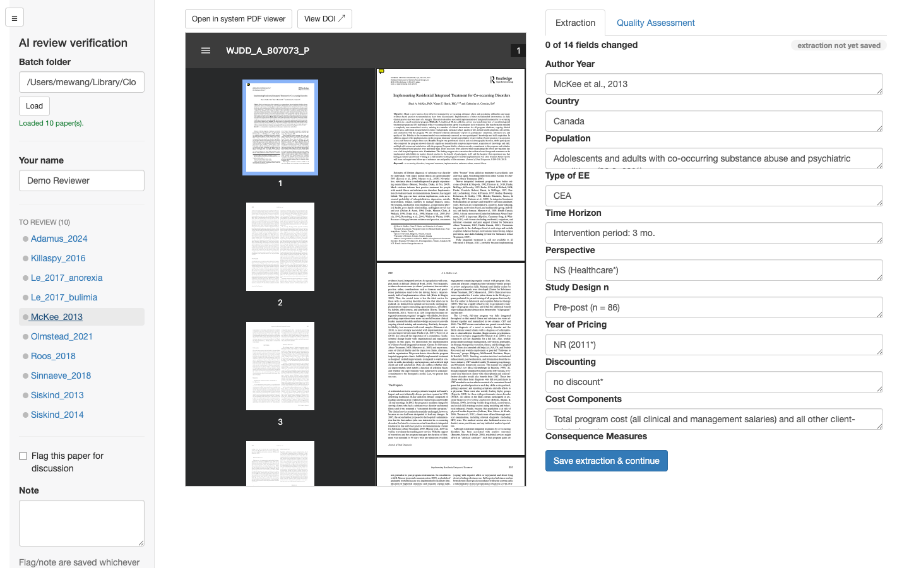
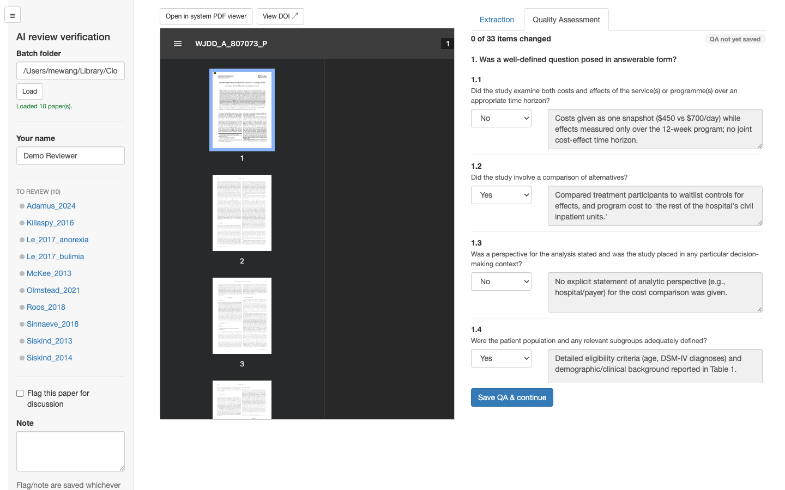
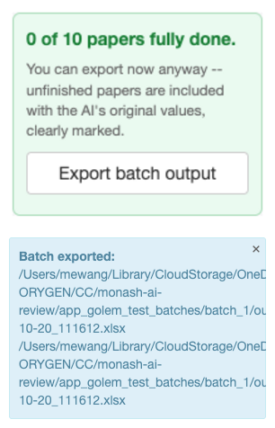

# CoReview

``` r

library(CoReview)
```

[CoReview](https://github.com/MUHEG/CoReview) is a Shiny app for
checking and correcting AI-generated data extraction and Drummond
quality-appraisal results against the original source PDFs, as part of
an AI-assisted health economic literature review.

Reviewers work through papers one at a time: the source PDF sits
alongside the AI’s extracted data, so every field and QA verdict can be
checked and corrected at a glance.

## Setting up a review

Before reviewers start, the AI pipeline’s extraction and QA spreadsheets
are split into one self-contained batch folder per reviewer with
[`split_for_review()`](https://MUHEG.github.io/CoReview/reference/split_for_review.md).
This is typically run once by whoever is coordinating the review, not
something individual reviewers need to worry about. See
[`?split_for_review`](https://MUHEG.github.io/CoReview/reference/split_for_review.md)
for details.

## Reviewing a paper

Launch the app pointed at a batch folder:

``` r

run_app(batch_dir = "review_batches/batch_1", reviewer = "Jane Doe")
```

(`batch_dir` and `reviewer` are both optional – without `batch_dir` the
app opens with a folder picker instead, and `reviewer` just pre-fills
the reviewer name on save.)

The sidebar lists every paper in the batch; selecting one opens its PDF
and AI-extracted data side by side.

### Extraction

Each field shows the AI’s extracted value, editable inline. A field a
reviewer actually changes is tracked (and later highlighted in the
exported deliverable) so it’s clear what was AI output versus
human-corrected.



### Quality Assessment

The Quality Assessment tab covers the Drummond checklist’s 33 sub-items.
Each has the AI’s verdict, editable, alongside its supporting evidence
quote – display-only, since that’s the AI’s own justification for the
verdict, not something a reviewer rewrites.



### Saving and moving between papers

“Save extraction & continue” / “Save QA & continue” record what’s
changed and update the status badge and change counter for that section.
Switching to a different paper – from the sidebar, or automatically
after both sections of the current one are saved – always opens back on
the Extraction tab.

A reviewer can export their own batch at any point with the app’s
“Export batch output” button, useful as a checkpoint partway through,
without waiting for the whole batch to be finished:



## Combining all batches

Once reviewing is done (or to check progress partway through),
[`combine_reviewed()`](https://MUHEG.github.io/CoReview/reference/combine_reviewed.md)
merges every batch into the two final verified deliverables, with every
reviewer-changed cell highlighted. See
[`?combine_reviewed`](https://MUHEG.github.io/CoReview/reference/combine_reviewed.md)
for details.
